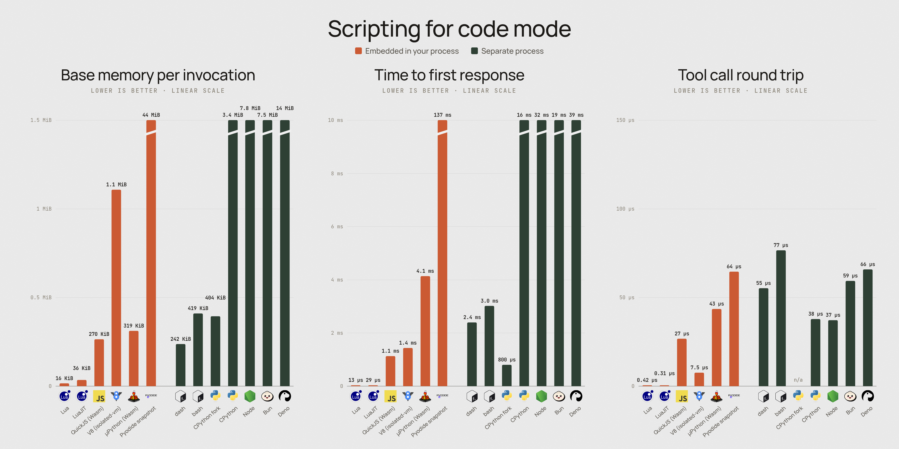
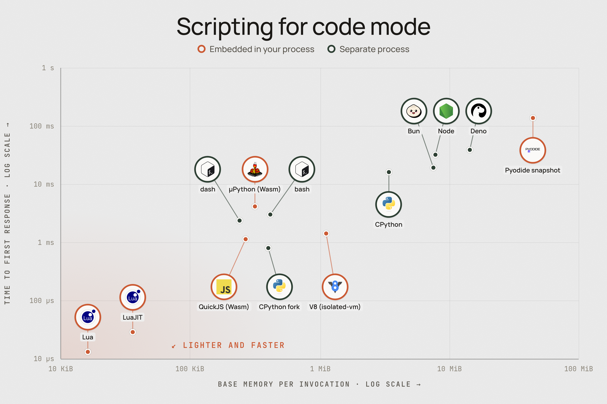
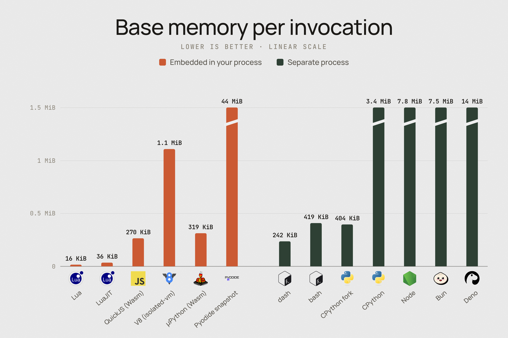
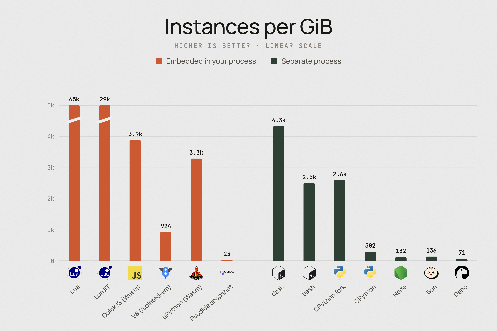
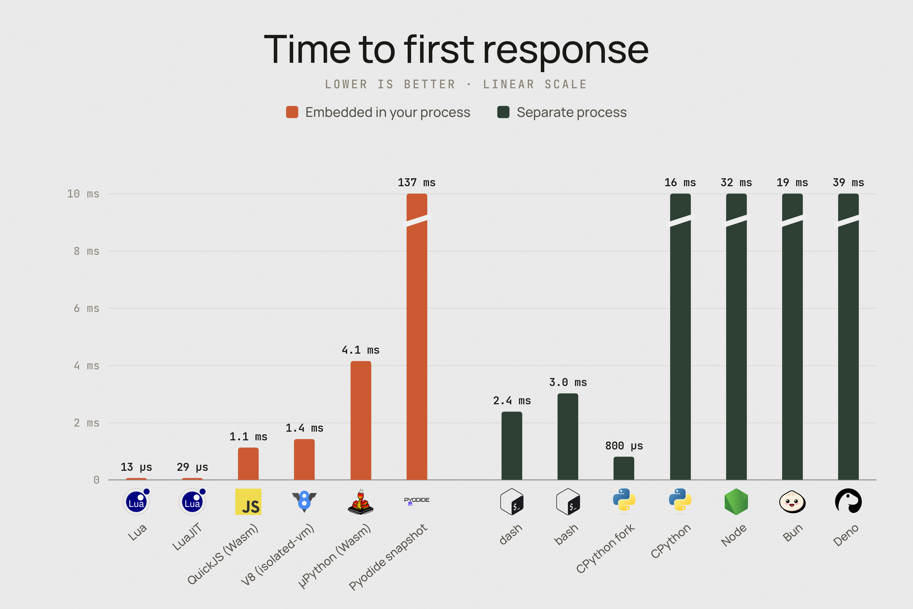
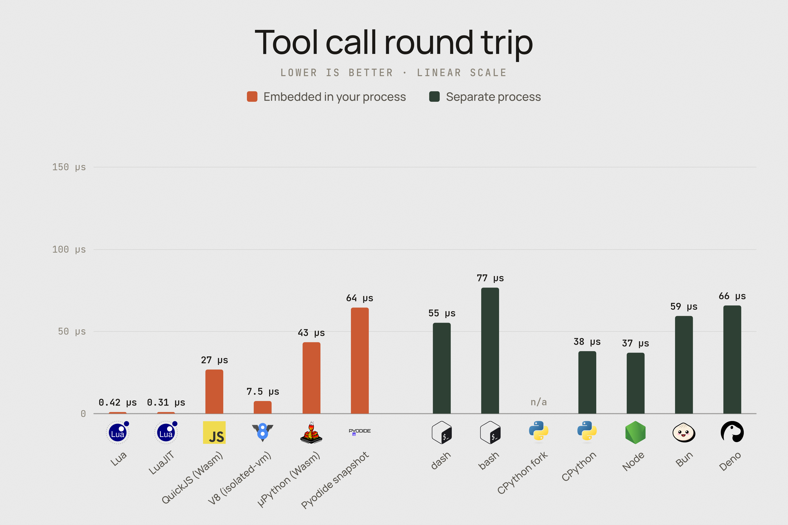
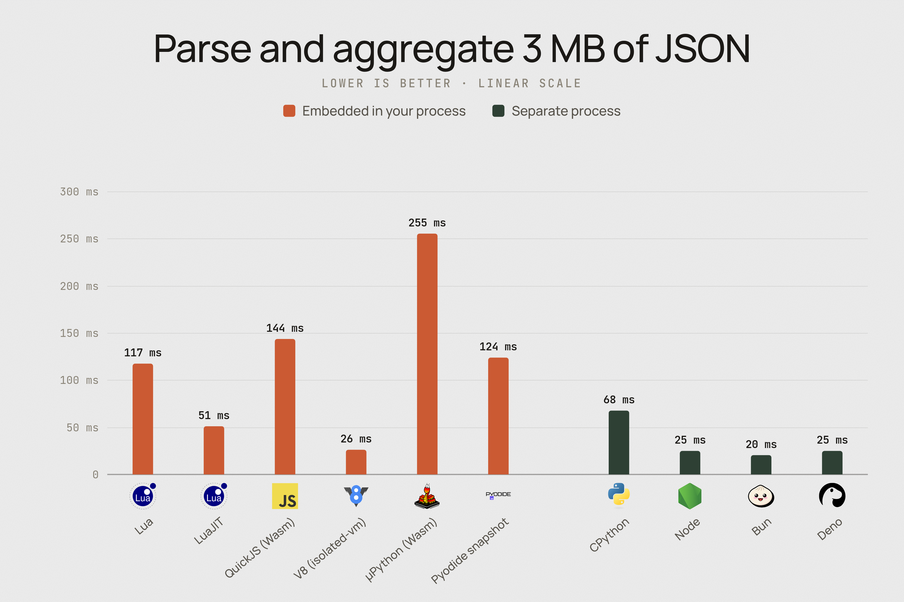

# Code mode language benchmark

In code mode, a model answers a request by writing a short script that calls the host's tools, instead of calling the tools one at a time itself. Every script runs in a fresh, isolated interpreter, so the interpreter's cost per invocation decides how many scripts one host can keep alive, how much latency each one adds before it does anything useful, and how expensive each tool call is. This repository measures those costs for the scripting runtimes a host is likely to embed or spawn.

A runtime is either embedded in the host process (a Lua state, a V8 isolate, an interpreter compiled to WebAssembly, an engine hosted in Rust) or run as a separate process (Node, Deno, Bun, CPython, bash, dash). Both kinds are measured with the same definitions, so they can sit in one table.

## What is measured

**Base memory per invocation** is the memory one more instance adds above the baseline, measured while it sits idle after answering `1 + 1`. For embedded runtimes it is the host's resident memory growth divided by the number of live instances. For processes it is the growth of the cgroup's `memory.current` per added process, with the measuring script running inside `systemd-run --user --scope -p MemoryAccounting=yes`, so it includes the kernel's memory for each process, such as page tables and kernel stacks.

**Time to first response** runs from creating a fresh instance until the host reads its answer to `1 + 1`. An embedded runtime creates its isolate, state or module and then evaluates. A process is timed from spawn until the host reads its first line of output. Node, Deno and Bun each print with their own console I/O, because Bun's Node-compatible stdout costs it about 15 ms at startup. The median is reported.

**Tool call round trip** is measured in an instance that is already running. Script code sends one JSON tool call, `{id, tool, args}`, and waits for the reply, and the host answers at once. Processes exchange JSON lines over stdio, reading lines natively in Deno and Bun, and the host times every call to report the true per-call median. Embedded calls take from well under a microsecond to tens of microseconds, so the embedded harnesses time batches of 100 to 10,000 calls and report the median batch's mean time per call.

**Compute** parses and aggregates 3 MB of JSON: 20,000 orders from a deterministic generator, grouped by region and customer. Every runtime uses a native JSON parser. Lua and LuaJIT use lua-cjson 2.1.0.20, built from its release source rather than installed. Each runtime runs the task nine times in one process, discards two warm-up runs and reports the median of the other seven, and every run's result must match a reference checksum.

**Instances per GiB** is 1 GiB divided by base memory.

## Results

<!-- results:start -->
<!-- Generated by scripts/update_readme.mjs from results/*.json. Edits here are overwritten. -->

Measured on November 19, 2026, between 1:58 PM and 2:01 PM PST on AMD EPYC 7443P 24-Core Processor with 48 logical cores (Debian GNU/Linux 13 (trixie), kernel 6.12.116+deb13-amd64). The 1-minute load average ran from 7.1 to 12.1 during the measurements.

| Runtime | Language | Runs as | Base memory | Instances per GiB | Time to first response | Tool call round trip | Parse and aggregate 3 MB of JSON |
| --- | --- | --- | ---: | ---: | ---: | ---: | ---: |
| Starlark | Starlark | embedded in Rust | 6.82 KiB | 153,743 | 5.59 µs | 0.187 µs | n/a |
| Monty | Python (subset) | embedded in Rust | 12.4 KiB | 84,647 | 2.69 µs | 2.9 µs | n/a |
| Lua | Lua | embedded in C | 16.2 KiB | 64,742 | 13.2 µs | 0.422 µs | 117 ms |
| LuaJIT | Lua | embedded in C | 36.1 KiB | 29,079 | 28.7 µs | 0.312 µs | 51.4 ms |
| Koto | Koto | embedded in Rust | 47.3 KiB | 22,167 | 27.3 µs | 0.784 µs | n/a |
| QuickJS-ng (rquickjs) | JavaScript | embedded in Rust | 164 KiB | 6,376 | 70.3 µs | 0.748 µs | n/a |
| Luau | Luau | embedded in Rust | 190 KiB | 5,528 | 89.4 µs | 2.01 µs | n/a |
| Rhai | Rhai | embedded in Rust | 222 KiB | 4,731 | 114 µs | 0.924 µs | n/a |
| Roto | Roto | embedded in Rust | 251 KiB | 4,176 | 338 µs | 0.0518 µs | n/a |
| QuickJS (Wasm) | JavaScript | embedded in Node | 270 KiB | 3,880 | 1.13 ms | 26.7 µs | 144 ms |
| Boa | JavaScript | embedded in Rust | 311 KiB | 3,367 | 153 µs | 1.37 µs | n/a |
| µPython (Wasm) | Python | embedded in Node | 319 KiB | 3,283 | 4.14 ms | 43.5 µs | 255 ms |
| V8 (isolated-vm) | JavaScript | embedded in Node | 1.11 MiB | 924 | 1.43 ms | 7.53 µs | 26.1 ms |
| Rune | Rune | embedded in Rust | 2.2 MiB | 465 | 2.13 ms | 0.649 µs | n/a |
| Steel | Scheme | embedded in Rust | 12.2 MiB | 84 | 196 ms | 1.57 µs | n/a |
| Pyodide snapshot | Python | embedded in Node | 44.1 MiB | 23 | 137 ms | 64.5 µs | 124 ms |
| dash | Shell | separate process | 242 KiB | 4,326 | 2.39 ms | 55.2 µs | n/a |
| Lua (process) | Lua | separate process | 267 KiB | 3,921 | 2.45 ms | 29.7 µs | 117 ms |
| LuaJIT (process) | Lua | separate process | 320 KiB | 3,277 | 3.45 ms | 28.5 µs | 51.4 ms |
| CPython fork | Python | separate process | 404 KiB | 2,595 | 800 µs | n/a | n/a |
| bash | Shell | separate process | 419 KiB | 2,500 | 3.02 ms | 76.5 µs | n/a |
| CPython | Python | separate process | 3.39 MiB | 302 | 16.1 ms | 37.9 µs | 67.6 ms |
| Bun | JavaScript | separate process | 7.51 MiB | 136 | 19.2 ms | 59.4 µs | 20.3 ms |
| Node | JavaScript | separate process | 7.75 MiB | 132 | 32 ms | 37.1 µs | 25 ms |
| Deno | JavaScript | separate process | 14.4 MiB | 71 | 38.9 ms | 65.8 µs | 24.9 ms |

Embedded rows come first, then separate processes, each sorted by base memory. Lower is better in every column except instances per GiB. n/a marks a metric that was not measured for that runtime; its results file says why. Each `results/<runtime>.json` also carries notes with secondary numbers (private and proportional memory, CPU per call, batch medians), and `results/raw/` holds every harness's own output.

The charts cover thirteen runtimes: Lua, LuaJIT, QuickJS, V8, MicroPython and Pyodide embedded, and dash, bash, CPython (spawned and forked), Node, Bun and Deno as processes. The Lua process rows and the Rust-hosted engines appear only in the table.





<p>





</p>
<!-- results:end -->

## Running it

You need a Linux host with cgroup v2 and a systemd user session, so that `systemd-run --user --scope` works, and these tools on `PATH`:

- Node 22 and npm
- Deno and Bun
- `python3` (CPython 3)
- `lua` (5.5) and `luajit`, with their headers and static libraries under one prefix (`include/lua`, `include/luajit-2.1`, `lib/liblua.a` and `lib/libluajit.a`, as Homebrew installs them)
- `gcc`, `curl` and `tar`
- `bash` and `dash`
- `cargo` (stable Rust)
- `chromium`, to render the charts

Then install the JavaScript dependencies and run everything:

```sh
npm install
npm run bench
```

`npm run bench` runs every language one after another in a single sitting, writes one file per runtime to `results/`, then rewrites the results section of this README and regenerates `charts/`. A full run takes about four minutes once the Rust engines are built; their first build takes much longer. The Lua runner downloads lua-cjson from GitHub on its first run and checks its SHA-256 hash.

To run some languages only, name them: `npm run bench -- lua python`. The languages are `lua`, `javascript`, `python`, `shell` and `rust-hosted`. To rebuild only the README or only the charts from the results already on disk, run `npm run readme` or `npm run charts`.

Three environment variables change where tools are found. `LUA_PREFIX` points at the prefix that holds the Lua and LuaJIT headers and static libraries; it defaults to the prefix of the `lua` binary. `CARGO_TARGET_DIR` reuses an existing Rust build, with each engine built into its own subdirectory. `CHROMIUM` names the browser binary.

## Layout

```
benches/
  common/       shared process suite, cgroup memory, compute runner and dataset, results writer
  lua/          Lua and LuaJIT embedded in a C host and run as processes
  javascript/   V8 (isolated-vm) and QuickJS (Wasm) embedded in Node; Node, Deno and Bun processes
  python/       Pyodide and MicroPython embedded in Node; CPython spawned and forked
  shell/        bash and dash processes
  rust-hosted/  Luau, rquickjs, Rhai, Rune, Koto, Roto, Steel, Starlark, Boa and Monty in Rust
  fluency/      the language fluency eval, kept as it ran and not part of npm run bench
results/        one normalized file per runtime; raw/ keeps each harness's own output
charts/         the generated PNGs; src/ holds the chart pages and icons/ the logos
scripts/        run_all.mjs, update_readme.mjs and render_charts.mjs
docs/           the research report and notes behind the benchmark
```

Each language folder has a `run.mjs` that builds what it needs, runs its harnesses and writes `results/<runtime>.json`. Every results file has the same fields: `runtime`, `label`, `language`, `group` (`embedded` or `process`), `host`, `version`, `metrics`, `notes`, `measuredAt` and `loadAverage`. `metrics` holds `memoryBytes`, `startMs`, `toolCallUs`, `computeMs` and `instancesPerGiB`, each null when it does not apply. `notes` explains how each number was taken and adds secondary numbers, and `loadAverage` gives the 1, 5 and 15 minute load averages when the runtime's measurements started and ended.

## Caveats

The hosts differ. Embedded Lua and LuaJIT run in a small C host, the Rust-hosted engines run in Rust, and the other embedded runtimes run in Node, so every embedded number includes its own host's binding costs.

V8's tool call goes through isolated-vm. The reported number uses a same-thread binding built from isolated-vm's synchronous calls, which resolves the guest's promise the way deno_core ops do. isolated-vm's own async API is several times slower; `results/v8.json` has both.

Processes are launched and served from Node, so process start times and tool calls include the cost of Node's child process and stream handling on the host side.

The numbers come from a shared host with other work running, and nothing on it was paused. The load average is recorded for every runtime, and absolute numbers move from run to run, so compare rows from the same run.

Lua and LuaJIT time the compute task with `os.clock()`, which counts process CPU time, because standard Lua has no finer clock. Their compute samples spread the most of any runtime on a busy host, so check the samples in `results/raw/lua/compute.json` before reading much into them.

Pyodide and MicroPython instances share one JavaScript realm, so they act as separate sandboxes only with their JavaScript bridges locked down, and MicroPython's bridge can serve host calls only for the newest instance in a realm.

The fluency eval in `benches/fluency` asked one model to solve the same ten tool-calling tasks in Python, JavaScript, Lua and bash. Every language scored 10 of 10, so the eval could not rank them and is not rerun.

## Further reading

`docs/report.md` is the research report this benchmark grew out of; `docs/index.html` renders it with its charts. `docs/notes/` holds the supporting notes, earlier probe scripts and the sanity checks behind the methods above.
